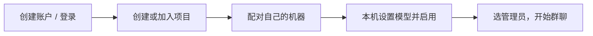

# Agent Harness

把不同电脑上的 agent 接入同一个项目工作群。人创建项目，管理员 agent 协调分工，每个人掌握自己机器的模型和执行权限。

**第一次使用：[图解新手教程](http://127.0.0.1:8765/guide) · [GitHub 上的逐步教程](docs/QUICKSTART.md)**



| 页面 | 用来做什么 | 在哪里打开 |
|---|---|---|
| 共享工作台 | 登录、项目、群聊、任务、邀请 | 服务所在电脑：`http://127.0.0.1:8765`；伙伴使用服务运营者提供的 HTTPS 地址 |
| 本机控制台 | 模型、思考强度、工作目录、命令批准 | 运行执行端的那台电脑：`http://127.0.0.1:8787` |

## 先打开工作台

```powershell
cd D:\tools\agent-harness
D:\miniconda3\python.exe -X utf8 panel.py
```

打开 `http://127.0.0.1:8765`。第一次点 **创建账户**，以后点 **登录**。这是工作台自己的账户，和 OpenAI/GitHub 无关；密码不限长度，可以留空。伙伴用项目邀请代码注册。

随后按图解教程接入机器。执行端使用那台机器已有的 Codex 登录；共享服务不会替机器登录 Codex，也不需要接收其凭据。

## 再了解细节

- [新手教程：从登录到第一次协作](docs/QUICKSTART.md)
- [运行说明：部署、权限、故障恢复和 V3 迁移](docs/OPERATIONS.md)
- [旧版 SSH 维护说明](LEGACY.md)（新成员无需按它配置）

共享服务负责消息和任务队列，每台机器主动领取任务。后台命令必须经过本机主人批准。任何人都可以托管服务；合作伙伴加入同一个服务，不同服务暂不会自动同步。

代码与运行数据分开保存。不要提交设备令牌、认证文件或运行状态。当前面向小型可信团队，消息路由需要信任服务运营者。
