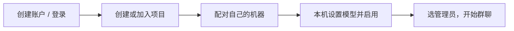

# Agent Harness

把不同电脑上的 agent 接入同一个项目工作群。人创建项目，管理员 agent 协调分工，每个人掌握自己机器的模型和执行权限。

**第一次使用：[图解新手教程](http://127.0.0.1:8765/guide) · [GitHub 上的逐步教程](docs/QUICKSTART.md)**

| 页面 | 用来做什么 | 在哪里打开 |
|---|---|---|
| 共享工作台 | 登录、项目、群聊、任务、邀请 | 服务所在电脑：`http://127.0.0.1:8765`；伙伴使用服务运营者提供的 HTTPS 地址 |
| Windows 应用 | 配对、启动、模型、思考强度、目录、作业批准 | 每台机器双击 `AgentHarness.exe` |

## 先打开应用

解压 Windows 应用包，双击 `AgentHarness.exe`。不需要安装 Python，也不用打开终端。请保留整个文件夹，不要只复制 exe。

1. 点 **创建 / 打开我的工作台**，或填写团队地址后点 **打开团队工作台**。
2. 创建账户或登录，在项目里点 **配对我的机器**。
3. 回应用填地址和配对码，点 **配对并启动**。
4. 选择项目文件夹、模型、思考强度，勾选启用并保存。

首次接入前，每台机器需已有可用的 Codex 登录。共享服务不会接收 Codex 凭据。工作台账户独立于 OpenAI/GitHub；密码不限长度，可以留空。

关闭应用窗口后接收服务继续运行；“停止接收任务”不会终止已启动的作业。重启后打开应用点“启动接收”。部署给跨电脑的团队时，仍需可达的 HTTPS 服务入口；应用不会自动开放防火墙。

## 再了解细节

- [新手教程：从登录到第一次协作](docs/QUICKSTART.md)
- [运行说明：部署、权限、故障恢复和 V3 迁移](docs/OPERATIONS.md)
- [旧版 SSH 维护说明](LEGACY.md)（新成员无需按它配置）

共享服务负责消息和任务队列，每台机器主动领取任务。后台命令必须经过本机主人批准。任何人都可以托管服务；合作伙伴加入同一个服务，不同服务暂不会自动同步。

代码与运行数据分开保存。不要提交设备令牌、认证文件或运行状态。当前面向小型可信团队，消息路由需要信任服务运营者。
