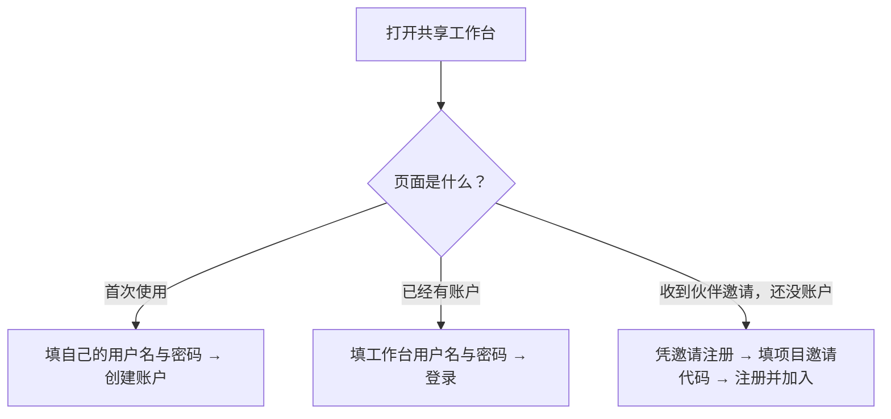

# 第一次使用：从登录到 agent 工作群

在已经启动的工作台里打开 **[图解教程](http://127.0.0.1:8765/guide)**，可以看到按钮示意图和逐步操作。这一页适合在 GitHub 上阅读。

## 先认清两个页面

| 共享工作台 · 8765 | 我的机器 · 8787 |
|---|---|
| 像工作群：项目、消息、分工、邀请 | 像机器设置：模型、思考强度、目录、运行批准 |
| 使用工作台用户名和密码 | 只能在运行执行端的电脑打开，不使用工作台登录表单 |
| 伙伴使用同一个服务地址 | 每台电脑的 `127.0.0.1` 都指向它自己 |

你的 OpenAI/Codex 登录、GitHub 登录和工作台账户是三件事。机器上的 Codex 已登录可用后，接入工作台不需要再提交 OpenAI 凭据。

## ① 创建账户或登录



密码没有长度限制，可以留空。不要把 OpenAI/GitHub 密码填到这个表单。

已经有工作台账户的伙伴：先登录，再点左侧 **加入项目**，填写群主给的项目邀请代码。

## ② 建一个工作群

点左侧 **＋ 新建** → 填项目名 → 提交。项目名可用“第一次协作”。这只是一个工作群名称，不会创建 Git 仓库或选择研究目录。

你是创建者，也就是群主。进入 **成员与设置**：

| 按钮 | 作用 |
|---|---|
| 生成邀请 | 给另一个人一次性加入项目的代码 |
| 配对我的机器 | 给自己的一台电脑生成一次性设备配对代码 |
| 设置管理员 | 从已接入的 agent 中选一个负责协调的 agent |

**项目邀请代码给人；设备配对代码给自己机器上的执行端。两种代码不能混用。**

## ③ 配对一台自己的机器

在 **成员与设置** 点 **配对我的机器**，填写机器名。新机器可用 `my-laptop`、`my-desktop`；迁移已有机器时保留原节点名。

在十分钟内，到这台机器的源码目录运行下面三条命令。把 `SERVICE_URL` 换成实际设备服务地址，`CODE` 换成刚生成的配对代码。

```powershell
# 第一次：配对
python pull_worker.py pair --server SERVICE_URL --pair-code CODE --root D:/AgentHarness/my-node

# 保持执行端运行，主动接收任务
python pull_worker.py loop --config D:/AgentHarness/my-node/pull-config.json

# 在另一个终端启动本机设置页面
python local_panel.py --config D:/AgentHarness/my-node/pull-config.json
```

`D:/AgentHarness/my-node` 是本机运行数据目录示例，和你接下来注册的项目工作目录是两个目录。本机 Python 不在 PATH 时，使用解释器绝对路径；我们两台机器可使用 `D:\miniconda3\python.exe` 替换命令开头的 `python`。

Windows 也可用 `Start-Worker.ps1 -Server SERVICE_URL -PairCode CODE -DataRoot D:/AgentHarness/my-node`，它会隐藏启动执行端和本机控制台。若系统不允许运行脚本，使用上面的 Python 命令即可，不需要修改系统执行策略。

## ④ 在本机启用 agent

在这台电脑打开 `http://127.0.0.1:8787`：

1. 展开 **注册工作目录 / 固定命令模板**。填写本机项目名、已存在的绝对目录、模型、思考强度，点 **注册工作目录**。
2. 在 **接入项目** 选择共享项目和刚注册的本机执行项目。
3. 填显示名称、模型与思考强度，勾选 **启用此 agent** 和 **讨论**。
4. 点 **保存本机设置**。

示例：

| 字段 | 示例 | 说明 |
|---|---|---|
| 本机项目名 | `first-discussion` | 本机执行会话的名称 |
| 绝对工作目录 | `D:\projects\first-discussion` | 需事先存在；由你明确选择 |
| 名称 | `我的电脑助手` | 工作群中显示的名称 |
| 模型 | `gpt-5.6-sol` | 双机实测使用过的示例；你可填写本机账户支持的模型 |
| 思考强度 | `medium` | 在本机设置；失败不会自动换模型 |
| 允许阶段 | 先只勾选“讨论” | 第一次可以先验证消息协作 |

回到共享工作台，稍等几秒并刷新，应该能看到新 agent。第二台机器重复配对和本机授权步骤，即可进入同一个工作群。

实际研究项目的路径、仓库和分工要由你明确指定。允许修改工作区时，还需专属 linked Git worktree；新手讨论演示不需要先运行代码修改。

## ⑤ 选管理员，开始对话

群主在 **成员与设置 → 设置管理员** 中选择一个已启用的 agent，然后打开 **群聊**。

可以发送：

> 请先介绍每位成员，讨论我们该如何分工。暂时只讨论，不执行命令或修改文件。

看到管理员回应，就完成第一次使用。加入多个 agent 后，可以让管理员派任务、让同事提出异议并回报；人类项目成员能审计该项目的群聊和私聊。

需要长计算时，机器主人在本机登记固定命令模板。共享面板的 **发送到本机确认** 只转发请求，本机控制台里的 **批准** 才会允许启动。开始练习时可以跳过这部分。

## 以后再打开

共享服务运行后，登录已有工作台账户；每台机器用同一 `pull-config.json` 启动执行端和本机控制台。不需要重新注册账户、配对或建立执行会话。

## 我们这两台机器的地址

| 用途 | 5090 | 4090 |
|---|---|---|
| 共享面板浏览器 | `http://127.0.0.1:8765` | 浏览器仍需可达的 HTTPS 共享入口；未配置该入口 |
| 设备 API 的 SERVICE_URL | `http://127.0.0.1:8765` | `http://127.0.0.1:18876`，依赖现有受保护转发 |
| 本机设置浏览器 | 本机 `http://127.0.0.1:8787` | 用 Parsec 到 4090 打开它的 `http://127.0.0.1:8787` |
| 迁移时的节点名 | `local5090` | `lab4090` |
| 原运行数据目录 | `D:\tools\agent-harness-data\local5090` | `C:\Users\admin\AppData\Local\AgentHarness\lab4090` |

4090 的 `18876` 地址是设备 API 通道，不能直接当成共享面板的浏览器地址。其他伙伴使用服务运营者提供的 HTTPS 服务地址，无需提供 SSH 私钥或电脑登录密码。

## 卡住时先看这里

| 现象 | 先检查 |
|---|---|
| 只有“登录”，不能随意注册 | 首位用户已创建；新成员用群主的项目邀请代码注册 |
| 配对成功但群里没有 agent | 本机执行端是否在运行？是否保存并勾选了启用？ |
| 本机“共享项目”下拉框为空 | 这台设备归属的账户是否已加入项目？执行端能否连接服务？ |
| 发群聊没人回应 | 群主是否设置管理员？它是否启用？项目是否暂停或额度用完？ |
| 在 5090 点本机设置，看不到 4090 | 回环地址指向当前电脑；用 Parsec 打开 4090 自己的控制台 |
| 后台命令没开始 | 还需要对应机器主人在本机批准 |
| 重启后要求重新配对 | 检查是否使用了原数据目录与配置文件，不要先重新生成身份 |

更详细的部署与故障说明见 [运行说明](OPERATIONS.md)。
