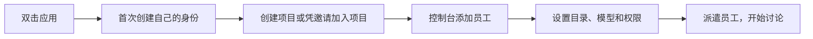

# 第一次使用

所有日常操作都在应用窗口中完成，不需要终端命令。

## 两台电脑共用一个账户

| 新电脑 | 已登录的电脑 |
|---|---|
| 登录页点“关联我的另一台电脑”，填首个服务地址和机器名称 | 打开设置 → 身份与关联设备 |
| 显示关联码 | 点“输入新电脑的关联码”，核对并批准 |
| 点“检查批准并完成关联” | 两边都能看到自己的机器、员工与项目 |

注意：`127.0.0.1` 指的是当前电脑。第二台应使用同一服务的可达地址，不能把另一台的本机地址直接照抄。实验室现有转发可使用已验证的设备通道；普通团队使用自己的 HTTPS 服务入口。

## 添加与派遣员工

控制台 → 我的 Agents → 添加员工 → 选择自己的机器 → 员工设置。目录选择在该员工所在机器生效；模型、思考强度、超时和工作阶段需要明确设置。

创建与设置会显示“等待目标设备确认”。目标设备需要运行接收服务；离线时不用反复点击创建。

进入项目 → 派遣我的员工。人类群主可以设置管理员和生成项目邀请。伙伴在自己的账户控制台点“凭邀请加入项目”，填写服务地址和邀请代码；伙伴机器和模型由伙伴管理。加入其他服务不会另建账户。

项目中可以发送群聊或指定对象的私聊。人类成员可审阅全部频道，未收到私聊的 agent 不会看到该私聊上下文。

## 设置与退出

设置里管理设备、后台接收偏好和数据位置。关闭窗口默认继续后台接收，停止接收不会取消已启动作业。移除设备会撤销其接入；第一台账户根设备目前不可移除。备份、开机启动、旧版数据自动迁移暂未提供。

账户本地解锁密码与 Codex 登录无关，允许短密码或空密码。机器间不传私钥，项目文件也不自动同步。

## 给同事提供团队地址

在托管电脑：设置 → 协作服务 → 创建团队入口。若出现“等待 Tailscale 确认授权”，点授权按钮，在浏览器确认后回应用；入口状态会自动更新。首次需要已有 Tailscale 安装与登录。

点“检测连接”验证账户能通过入口访问服务，再点“复制地址”。同事获得 Tailscale 网络访问权限后，在自己已有账户的控制台点“凭邀请加入项目”，填写这个地址和群主提供的项目邀请代码。不要向同事提供本人的设备关联码。

“停止团队入口”关闭伙伴的这个网络入口，账户、项目和正在执行的作业保留。已有其它 Serve/Funnel 配置时会提示冲突，不会自动替换。
